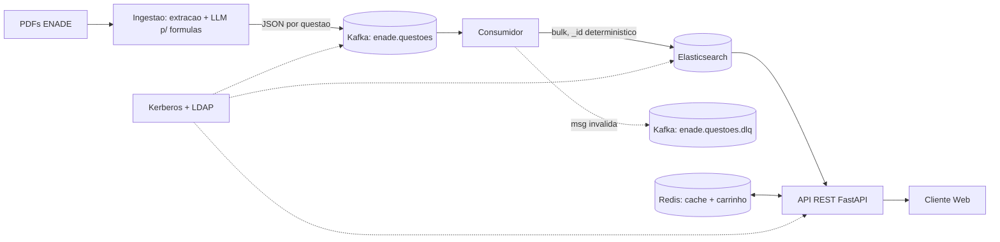

# Arquitetura e decisoes de topologia

## Fluxo

## Decisoes (preencher "Evidencia" com resultados reais depois)

| Componente | Decisao | Justificativa | Evidencia (a coletar) |
|---|---|---|---|
| Kafka | 1 broker, modo KRaft | Dispensa ZooKeeper; suficiente para laboratorio. Em producao: 3 brokers, RF=3, min.insync=2. | Teste de queda do broker (RNF04) |
| Topico `enade.questoes` | 6 particoes, RF=1 | Particoes sao o teto de paralelismo dos consumidores; 6 permite ate 6 consumidores no grupo. Chave da mensagem = id da questao, garantindo ordem por questao. | Vazao x numero de consumidores |
| Topico DLQ | 3 particoes | Trafego de erro esperado baixo. | Contagem de msgs na DLQ |
| Retencao | `retention.ms=-1` | Permite reprocessar o acervo sem reextrair os PDFs. | n/a |
| Elasticsearch | 1 no, indice com 3 shards primarios, 0 replicas (laboratorio) | O numero de shards nao muda depois sem reindexar, entao se define desde o inicio. Replicas so fazem sentido com mais de um no. | Latencia p95/p99 (RNF01) |
| Idempotencia (RF10) | `_id` = `curso-ano-tipo-numero` (ex.: `sistemas-de-informacao-2021-ce-009`) | Reprocessar sobrescreve em vez de duplicar. | Teste: ingerir 2x, contar docs |
| Consumidor (RF09) | Commit manual do offset apos o bulk no Elastic | At-least-once + idempotencia = efeito exatamente-uma-vez. | Teste de falha induzida |
| Redis | 1 instancia, AOF ligado, senha | Cache de buscas (TTL) e carrinho por sessao; AOF evita perder carrinhos em reinicio. | Hit rate |
| Seguranca | PLAINTEXT agora; Kerberos/LDAP na semana 4 | Evita depurar auth e pipeline ao mesmo tempo. | n/a |

## Pendencias da semana 1 (equipe)
- [ ] Preencher nomes e divisao de tarefas no README
- [ ] `docker compose up -d` rodando na maquina de todos e `smoke_test.sh` sem falhas
- [ ] Criar repositorio Git e dar acesso ao professor
- [ ] Definir responsaveis: extracao, Kafka/Elastic, API/Redis, web, seguranca/testes

---

# Semana 2: extracao e pipeline Kafka -> Elasticsearch

## Extracao (`ingestao/enade/extrator.py`)
| Etapa | Decisao | Limitacao conhecida (discutir no relatorio) |
|---|---|---|
| Leitura | pdfplumber, linha a linha com pagina e posicao | Provas em 2 colunas podem embaralhar a ordem das linhas |
| Segmentacao | Cabecalhos `QUESTAO NN` / `QUESTAO DISCURSIVA NN`; para no `QUESTIONARIO DE PERCEPCAO` | Layout muda entre edicoes: ajustar as regex por ano |
| Alternativas | Ultimo `A` seguido de `B..E` em ordem (evita confundir "A casa..." com alternativa) | Alternativas em colunas/imagens nao sao detectadas |
| Texto-base x enunciado | Corte no ultimo "comando" (`Com base`, `Assinale`...) que abre frase | Se nao achar, marca `segmentacao_incerta` |
| Gabarito | PDF separado, regex tolerante; `Anulada` -> `anulada=true` (nao descarta, RF03) | Conferir contra o formato real do INEP |
| Midia (RF04) | Tabela -> Markdown (ja na extracao); imagem -> `midia_pendente=true` + recorte PNG opcional | Imagem/formula -> LaTeX/Mermaid via LLM fica para a semana 3 |
| Rastreabilidade (RF06) | `origem.pdf`, `pagina_inicio`, `pagina_fim` em todo documento | n/a |
| Qualidade (RNF03) | Flags `qualidade.*` por documento + `scripts/amostra_validacao.py` | A taxa de acerto so vale com a amostra manual >= 50 |

Pendente (semana 3): `competencias` e `objetos_conhecimento` (vem das diretrizes/padrao de resposta, nao da prova) e coleta completa do acervo (RF01).

## Pipeline
- **Produtor**: `acks=all`, `enable.idempotence=true`, chave = id da questao (mesma questao sempre na mesma particao).
- **Consumidor**: commit manual APOS bulk no Elastic + DLQ entregue. Falha do Elastic: retry com backoff, sem commit.
- **DLQ** (`enade.questoes.dlq`): JSON quebrado, campo faltando ou rejeitado pelo mapping (`dynamic: strict`); header `erro` traz o motivo e `topico_origem/particao/offset` a origem.
- **Idempotencia**: `_id` deterministico + `index` (sobrescreve).
- **Mapping**: indexacao `lowercase > stop > asciifolding > stemmer brazilian`; busca acrescenta sinonimos (`synonym_graph updateable`, arquivo `ingestao/mapping/sinonimos.txt`) so no lado da consulta, para editar sinonimos sem reindexar.

## Experimentos desta semana (gerar evidencias para o relatorio)
1. Idempotencia: `scripts/teste_idempotencia.sh` (docs apos 1a vs 2a execucao).
2. DLQ: `produtor --injetar-invalida`, depois conferir a DLQ e que o fluxo seguiu.
3. Resiliencia: `scripts/teste_resiliencia.sh` (consumidor parado -> publica -> reinicia).
4. Vazao e lag: logs do consumidor (docs/s) e `scripts/verificar_pipeline.sh`.
5. Qualidade: `scripts/amostra_validacao.py` + conferencia manual.
