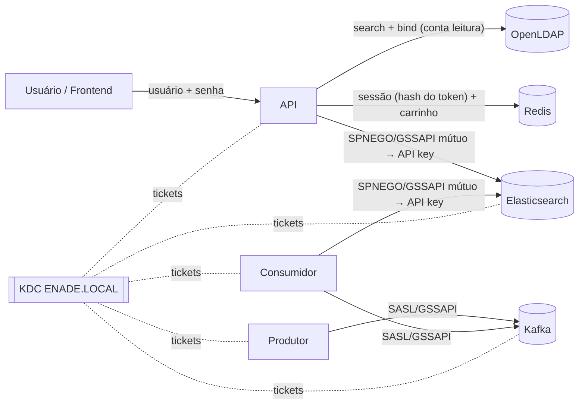

# Segurança: LDAP, perfis e Kerberos



## 1. Usuários (LDAP) e perfis

- Servidor: `osixia/openldap` (serviço `ldap`), base `dc=enade,dc=local`. O `ldap-init` roda
  [`infra/ldap/seed.sh`](../infra/ldap/seed.sh): cria `ou=usuarios`, `ou=grupos`, os grupos
  `cn=professores`/`cn=estudantes` e os usuários de demonstração com senhas do `.env` (hash SSHA).
- A API usa a conta de serviço **somente leitura** `cn=leitura,dc=enade,dc=local` para localizar o usuário
  pelo `uid` (valor escapado contra LDAP injection) e depois faz **bind com o DN do usuário e a senha
  digitada**: quem valida a senha é o LDAP. A API nunca grava senhas. Senha vazia é recusada antes do bind
  (evita o "unauthenticated bind" que o LDAP aceitaria).
- Perfil = grupo: `professores` → `professor`, `estudantes` → `estudante` (professor tem precedência).
  Fora dos dois grupos: 403 `USUARIO_SEM_PERFIL`.
- Para cadastrar um usuário: adicione a entrada `inetOrgPerson` em `ou=usuarios` e inclua o DN como
  `member` do grupo desejado (ex.: `ldapadd`/`ldapmodify` com `cn=admin`).

## 2. Sessões e controle de acesso

- Login devolve um token opaco aleatório (256 bits). No Redis fica só o **SHA-256** do token
  (`enade:sessao:{sha256}`) com TTL `SESSAO_TTL`, renovado a cada requisição (expiração por inatividade).
  Logout apaga sessão e carrinho.
- Bloqueio de força bruta: `LOGIN_MAX_FALHAS` erros em `LOGIN_JANELA_BLOQUEIO` segundos → 429.
- Permissões por perfil (`app/seguranca/sessoes.py`) e verificação por rota (`exigir_permissao`):

| Recurso | anônimo | estudante | professor |
|---|---|---|---|
| Pesquisar, filtrar, estatísticas | ✔ | ✔ | ✔ |
| Gabarito nas respostas | `null` | `null` | ✔ |
| Carrinho / exportar sem gabarito | 401 | ✔ | ✔ |
| Exportar com gabarito | 401 | **403** | ✔ |
| Painel `/api/painel/professor` | 401 | **403** | ✔ |
| Métricas / invalidação do cache | 401 | **403** | ✔ |

Testes: `api/tests/test_auth.py` (matriz 401/403/200 parametrizada), `test_carrinho_exportacao.py`.

## 3. Kerberos (autenticação mútua entre componentes)

Ativado com a sobreposição `docker-compose.kerberos.yml`:

```bash
cp .env.example .env    # defina KRB5_MASTER_PASSWORD e ELASTIC_PASSWORD (além das outras senhas)
docker compose -f docker-compose.yml -f docker-compose.kerberos.yml up -d --build
./scripts/teste_kerberos.sh
```

### KDC e principals
[`infra/kerberos/kdc-entrypoint.sh`](../infra/kerberos/kdc-entrypoint.sh) cria o realm `ENADE.LOCAL`
e os principals com **chave aleatória** (nenhuma senha de serviço existe). Os keytabs vão para
`secrets/keytabs/` (ignorado pelo Git) e são montados somente leitura em cada container.

| Principal | Componente | Uso |
|---|---|---|
| `kafka/kafka` | broker Kafka | aceitador SASL/GSSAPI |
| `kafka-admin` | ferramentas CLI | criação de tópicos, healthcheck |
| `produtor`, `consumidor` | pipeline | clientes Kafka (GSSAPI) e Elasticsearch |
| `HTTP/elasticsearch` | Elasticsearch | aceitador SPNEGO (realm `kerb1`) |
| `api` | API | cliente do Elasticsearch |

### Kafka: SASL/GSSAPI
- Listeners `INTERNAL` e `EXTERNAL` em `SASL_PLAINTEXT` com `sasl.enabled.mechanisms=GSSAPI`,
  inclusive entre brokers (`sasl.mechanism.inter.broker.protocol=GSSAPI`). JAAS em
  [`infra/kerberos/kafka_jaas.conf`](../infra/kerberos/kafka_jaas.conf).
- Produtor/consumidor (`ingestao/enade/config.py → kafka_seguranca()`): `security.protocol=SASL_PLAINTEXT`,
  `sasl.mechanisms=GSSAPI`, `sasl.kerberos.service.name=kafka`, principal e keytab por variável de ambiente.
- O wheel do `confluent-kafka` no PyPI vem **sem** GSSAPI; o `ingestao/Dockerfile` compila o librdkafka
  com libsasl2 (Cyrus + plugin GSSAPI do MIT) e o `confluent-kafka` contra ele (o build falha se GSSAPI não estiver ativo).
- No GSSAPI o cliente obtém do KDC um ticket para `kafka/kafka` que só o broker consegue abrir, e o broker
  prova sua identidade de volta: a autenticação é mútua por construção. Cliente sem Kerberos é recusado.

### Elasticsearch ↔ API / consumidor: SPNEGO com verificação do servidor
1. O cliente obtém credenciais do seu keytab e cria um contexto GSSAPI para `HTTP@elasticsearch` com a flag
   `mutual_authentication`.
2. Envia o ticket SPNEGO (`Authorization: Negotiate <ticket>`) em `POST /_security/api_key`. O Elasticsearch
   valida o ticket com o keytab dele (realm `kerb1`).
3. O Elasticsearch responde com `WWW-Authenticate: Negotiate <token de resposta>`.
4. O cliente passa esse token ao contexto GSSAPI. Se o servidor não for o `HTTP/elasticsearch` legítimo,
   a verificação falha e a conexão é recusada (`FalhaAutenticacaoMutua`).
5. A API key criada pertence ao próprio principal (mesmos papéis), vale 1 h e a API a renova antes de expirar.

Por que não `POST /_security/oauth2/token` com `grant_type=_kerberos`? Esse endpoint exige que a chamada
já venha autenticada por outro usuário com o privilégio `manage_token`, o que obrigaria a guardar uma
senha de serviço. Com SPNEGO + API key própria, nenhuma senha é necessária (verificado no teste ponta a ponta).

Autorização no Elasticsearch ([`infra/kerberos/es-init.sh`](../infra/kerberos/es-init.sh)):
`api@ENADE.LOCAL` → papel `enade_leitura` (somente leitura); `consumidor@`/`produtor@` → `enade_escrita`.
Os dois papéis têm `manage_own_api_key` (cada principal só cria/gerencia as próprias chaves).
Requisição anônima ao Elasticsearch → 401.

### Testes
- Unitários (`api/tests/test_kerberos.py`): envio do ticket SPNEGO, verificação do token de resposta, rejeição de
  servidor impostor/sem token de resposta/ticket recusado, reutilização do token e configuração GSSAPI do Kafka.
- Ponta a ponta ([`scripts/teste_kerberos.sh`](../scripts/teste_kerberos.sh)): keytabs gerados; cliente Kafka
  com Kerberos lista tópicos e cliente sem Kerberos é recusado; Elasticsearch recusa requisição anônima; API
  autenticada (log de autenticação mútua); ticket para serviço errado recusado; pipeline completo
  produtor → Kafka → consumidor → Elasticsearch → API usando apenas Kerberos.

### Limitações (laboratório)
- `SASL_PLAINTEXT` e HTTP sem TLS: Kerberos autentica, mas não cifra o tráfego. Em produção, usar
  `SASL_SSL` e HTTPS no Elasticsearch (e LDAPS).
- Licença `trial` do Elasticsearch (o realm Kerberos é recurso pago; o trial vale 30 dias).
- Segurança ligada sem TLS no transporte só é aceita porque o nó é único (`discovery.type: single-node`).
- Keytabs com permissão 644 para simplificar UIDs diferentes entre containers.
- O cliente Kafka só funciona dentro da rede Docker (o principal do broker é `kafka/kafka`).
- O consumidor obtém a API key ao conectar e não a renova (a API renova). Quando a chave
  expira (1 h), o bulk recebe 401, o lote **não** é confirmado no Kafka e o processo termina;
  o Docker o reinicia (`restart: unless-stopped`), ele obtém um novo token e reprocessa o lote (sem perda,
  at-least-once + `_id` idempotente). Melhoria futura: renovar o token como a API faz.
- Kibana fica desligado no modo Kerberos.
